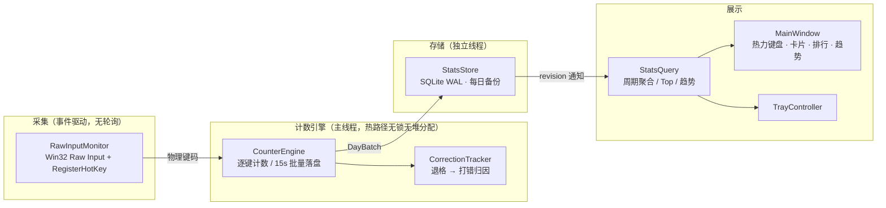

<div align="center">

# ⌨️ keyCounter

**常驻 Windows 托盘的按键计数与热力统计工具**

统计每个物理按键的按下次数与「打错」次数，用一张*热力虚拟键盘*让你一眼看清
哪些键被高频使用、哪些键最容易打错 —— 按 日 / 周 / 月 / 年 / 累计 查看。

[![C++][badge-cpp]](https://isocpp.org) [![Qt][badge-qt]](https://www.qt.io)
[![Windows][badge-win]](#) [![Zero third-party deps][badge-deps]](#)
[![License][badge-license]](#)


</div>

---

## 目录

- [快速上手](#快速上手)
- [用户手册](#用户手册)
  - [1. 托盘图标与启动方式](#1-托盘图标与启动方式)
  - [2. 统计面板](#2-统计面板)
  - [3. 热力虚拟键盘](#3-热力虚拟键盘)
  - [4. 「打错」是怎么统计的](#4-打错是怎么统计的)
  - [5. 暂停统计](#5-暂停统计)
  - [6. 设置详解](#6-设置详解)
  - [7. 数据存放、迁移与便携模式](#7-数据存放迁移与便携模式)
  - [8. 命令行参数](#8-命令行参数)
  - [9. 隐私承诺](#9-隐私承诺)
  - [10. 已知限制与 FAQ](#10-已知限制与-faq)
- [技术栈](#技术栈)
- [架构](#架构)
- [从源码构建](#从源码构建)
- [打包发布](#打包发布)
- [测试与实测性能](#测试与实测性能)
- [目录结构](#目录结构)
- [文档与规划](#文档与规划)

---

## 快速上手

1. **运行** `keyCounter.exe`（免安装绿色目录，见 [打包发布](#打包发布)）。
   首次启动会在托盘出现图标并弹出提示：*“已在后台开始统计，只保存逐键的聚合计数”*。
2. **查看统计**：单击（或双击）托盘图标打开统计面板；右键托盘图标可打开菜单。
3. **让它常驻**：在托盘菜单勾选 *开机静默启动*（写入 `HKCU\...\Run`，不需要管理员权限），
   之后每次开机都静默运行在托盘。
4. 重复运行 `keyCounter.exe` 不会开出第二个进程 —— 只会**唤起已有的面板**（单实例）。

> 关掉面板窗口 ≠ 退出程序：窗口关闭后只是隐藏回托盘，统计继续。
> 想彻底退出：托盘右键 → *退出 keyCounter*。

---

## 用户手册

### 1. 托盘图标与启动方式

| 操作 | 效果 |
|------|------|
| 左键单击 / 双击图标 | 打开（或唤起）统计面板 |
| 右键图标 | 托盘菜单：打开统计面板 / 暂停统计 / 键盘布局 / 开机静默启动 / 设置… / 退出 |
| 悬停图标 | 提示气泡：今天按键次数、打错修正次数、当前快捷键 |

托盘图标的圆环会随**今天相对近 30 天日均用键强度**变化，今天打得越多、圆环越“热”；
暂停统计时图标显示暂停态。菜单与提示每 60 秒自动刷新。

### 2. 统计面板

面板从上到下分四个区域：

```
┌ 顶部栏   [状态行]        今天·本周·本月·今年·累计   ⏸ 暂停   ⚙ 设置 ┐
├ 概览卡片  本期键击 │ 打错修正 │ 最高频键 │ 日均键击              │
├ 热力键盘（左，占 3/4）  │  Top 12 排行（右：高频 / 打错 两个页签）  │
└ 趋势图     [按天] / [时段] 两个页签，支持“聚焦某个键”            ┘
```

- **周期选择器**：*今天 / 本周 / 本月 / 今年 / 累计*（“本周”按你设置的每周起始日计算）。
- **概览卡片**：当前周期内的总键击、打错修正次数、最高频键及其次数、日均键击。
- **Top 12 排行**：*高频* 页签按按下次数排序；*打错* 页签按“归因到该键的退格次数”排序。
  点击排行中的一行 = 聚焦该键（见下）。
- 面板打开时数据约每 16 秒自动刷新一次，与落盘周期对齐；状态行每 2 秒刷新。

### 3. 热力虚拟键盘

- 1:1 真实比例的自绘键盘，内置三套布局，可在托盘菜单或 *设置 → 常规* 中切换：
  - **104 键全尺寸 (ANSI)**
  - **87 键 TKL（无小键盘）**
  - **68 键小配列 (65%)**
- 每个键按“该周期内按下次数 / 周期内最大次数”映射到热力色带；**无色 = 该周期内没按过**。
- 三套热力色带（*设置 → 常规 → 热力色带*，带实时预览）：
  | 色带 | 配色 |
  |------|------|
  | 熔岩 Ember（默认） | 青 → 绿 → 黄 → 橙 → 红 → 深红，越红越热 |
  | 热焰 Inferno | 深红 → 橙 → 金黄，越亮越热 |
  | 色盲友好 | 蓝 → 青 → 黄 → 砖红，红绿色盲可辨 |
- **计数按物理键位**：左/右 Shift、左/右 Ctrl、主回车与小键盘回车等分别统计、分别上色。
- **悬停**任意键显示其名称与次数；**单击**某个键进入*聚焦模式*：下方趋势图切换为该键
  的逐日曲线 / 时段分布，点 *返回总览* 退出。

### 4. 「打错」是怎么统计的

两种口径（*设置 → 统计与数据 → 错误统计* 切换，基于同一份数据，随时可换）：

| 口径 | 含义 | 回答的问题 |
|------|------|-----------|
| **归因**（推荐） | 把每次 退格/删除 记到“刚打错的那个键”头上 | 哪个键最常让我打错？ |
| **字面** | 只统计 Backspace / Delete 键本身被按了多少次 | 我一共删了多少下？ |

### 5. 暂停统计

不想被统计（比如给别人打字、玩游戏）时：

- 面板右上角的 **⏸** 按钮：一键暂停/恢复（暂停期间不计数，界面显示暂停徽标）；
- 或托盘菜单 **暂停统计**：*恢复 / 暂停 1 小时 / 暂停到明天 / 暂停直到手动恢复*。

### 6. 设置详解

托盘右键 → *设置…*（或面板右上角 ⚙），共四个页签：

| 页签 | 可选项 |
|------|--------|
| **常规** | 开机静默启动（显示注册表登记状态）；主题：*跟随系统 / 深色 / 浅色*；热力色带（带预览）；键盘布局；每周起始：*周一 / 周日*；*减少动画*；*显示时段分布图* |
| **快捷键** | 启用全局快捷键（**默认关闭**），组合键自定义（如 `Ctrl+Alt+K`，须含至少一个修饰键）。开启后任何时候按下都会唤起面板；冲突时会自动关闭并在托盘提示 |
| **统计与数据** | 错误统计口径（归因/字面）；数据位置（*更改位置… / 打开数据目录 / 恢复默认位置*）；*清空所有统计数据*（二次确认） |
| **关于** | 版本与技术要点、**已知限制**、**统计说明**（长按只记 1 次、物理键位分别统计、每 15 秒落盘） |

### 7. 数据存放、迁移与便携模式

- **默认位置**：`%APPDATA%\keyCounter\keycounter.db`（SQLite，WAL 模式，一年数据约 2 MB）。
- **每日备份**：数据目录下 `backup\keycounter-YYYYMMDD.db`，自动保留最近 **7 份**。
- **更改位置**：*设置 → 统计与数据 → 更改位置…* 可把数据迁到任意目录（D 盘、移动硬盘）；
  迁移时数据库与备份一并搬走，原目录不留副本；若目标目录已有数据，可选择
  *迁移并覆盖* 或 *直接接管已有数据*。
- **便携模式**：在 exe 同级目录放一个空的 `portable.flag` 文件，数据即写到 exe 旁边的 `data\`，
  整个文件夹拷到哪都带着自己的统计走。
- 所有计数先 accumulate 在内存，每 **15 秒**或跨零点 / 休眠 / 会话锁定 / 退出时批量落盘，
  断电最多丢十几秒。

### 8. 命令行参数

```powershell
keyCounter.exe              # 打开面板（已有实例时只唤起）
keyCounter.exe --silent     # 静默启动：只进托盘，不开窗（开机自启用的就是它）
keyCounter.exe --dump       # 不启动 GUI，在控制台打印 今天/本周/本月/今年 汇总与 Top 榜
```

### 9. 隐私承诺

- 只保存**逐键的聚合计数**（物理键 + 次数）——*不保存按键序列，无法还原你打了什么字*；
- 不记录窗口标题、前台程序名；
- **不联网、不上报**；采集使用 Raw Input，**不注入、不挂钩**其他进程。

### 10. 已知限制与 FAQ

| 现象 | 原因 |
|------|------|
| 某些窗口里的按键没被统计 | 以**管理员身份**运行的程序，普通权限进程收不到其按键（Windows UIPI）；UAC 弹窗、锁屏属于安全桌面，同样不投递按键 |
| Fn 键永远是 0 | Fn 由键盘硬件处理，不产生系统键码 |
| 按住不放会不会一直 +1？ | 不会，只在按下瞬间计 1 次 |
| 托盘图标没了但程序还在？ | Windows 可能把新图标收进溢出区，任务栏设置里允许其始终显示即可 |
| 清空/迁移数据后累计周期 | 累计 = 自**当前数据库**第一个有数据的日期起算 |

---

## 技术栈

**零第三方依赖**：Qt 6.8.2 官方模块 + Win32 API 即全部依赖。

| 层 | 选型 | 为什么 |
|----|------|--------|
| 语言 / 构建 | **C++20** · CMake 3.21+ · MSVC 2022 · Ninja | 与 Qt `msvc2022_64` 工具链一致；`/W4 /permissive- /utf-8` |
| UI | **Qt Widgets + 全自绘（QPainter）** | 常驻内存最低、启动最快；热力图/图表/卡片全部自绘，视觉完全可控 |
| 按键采集 | **Win32 Raw Input**（`RIDEV_INPUTSINK`） | 不注入、不钩挂其他进程，异步低开销，应用失焦也能收到按键；扫描码 + E0/E1 前缀区分物理左右键 |
| 纠错归因 | 自研 `CorrectionTracker` | 基于最近击键缓冲，把每次退格归因到“刚打错的键” |
| 存储 | **SQLite**（Qt 自带 QSQLITE 驱动） | WAL + 每日备份 + 批量 upsert，崩溃安全；年数据量约 2 MB |
| 单实例 | QtNetwork **QLocalServer / QLocalSocket** | 第二次启动 → 唤起已有面板 |
| 托盘 / 自启 / 快捷键 | QSystemTrayIcon · QSettings(注册表) · `RegisterHotKey` | 原生 Win32 行为，免额外依赖 |
| 测试 | **QTest**（7 个套件）+ 自研微基准 | 引擎/存储/布局/采集全链路可测 |

## 架构



核心库 `kccore`（采集/统计/存储/布局）**不依赖 Qt Widgets**，可独立编译测试；
UI 层只做绘制与交互。

## 从源码构建

依赖：Qt 6.8.2 `msvc2022_64`（需 Core/Gui/Widgets/Sql/Network/Test 组件）+ MSVC 19.44 + Ninja 1.13（本机已验证）。

```powershell
cmake -S . -B build -G Ninja `
  -DCMAKE_PREFIX_PATH=D:/Qt6/6.8.2/msvc2022_64 `
  -DCMAKE_BUILD_TYPE=Release
cmake --build build

# 运行（未部署时需把 Qt 的 bin 目录加进 PATH）
$env:PATH = "D:/Qt6/6.8.2/msvc2022_64/bin;$env:PATH"
.\build\keyCounter.exe

# 测试与工具
cd build; ctest --output-on-failure    # 7 个测试套件
.\keyCounterBench.exe 1000000          # 按键热路径微基准
.\keyCounterRawProbe.exe 15            # 采集探针：实时打印捕获到的按键
```

## 打包发布

```powershell
powershell -ExecutionPolicy Bypass -File tools/deploy.ps1
# → dist/keyCounter/（约 44 MB：exe + Qt 运行时 + platforms + styles + sqldrivers/qsqlite.dll）
```

- `sqldrivers/qsqlite.dll` 必须随包分发，否则统计数据库无法读写（脚本已自动复制）。
- 应用图标由 `keyCounterIconGen` + `tools/pack-ico.py` 生成（`resources/app.ico`，16→256 px 共 7 个尺寸）。

### 开发工具（tools/）

| 工具 | 用途 |
|------|------|
| `gen-demo-data.py` | 生成“像真人打字”的演示数据（45 天 ≈ 46 万键击），检查热力配色 |
| `check-db.py` | 只读查看数据库：逐日逐键计数、时段分布、meta |
| `inject-test.ps1` | 注入 F13 验证采集链路（真实键盘不会产生该键） |
| `screenshot-app.ps1` | 无前台窗口也能截图主面板（PrintWindow） |
| `analyze-shot.py` | 对截图做像素级校验（主题色 / 热力色带命中统计） |

## 测试与实测性能

| 指标 | 实测（Release，本机） | 目标 |
|------|------|------|
| 按键热路径 | **35 ns / 次** | < 2000 ns |
| 静默托盘态内存 | **28.7 MB 工作集 / 6.9 MB 私有** | < 45 MB |
| 空闲 CPU | **0%**（纯事件驱动，无轮询） | ≤ 0.05% |
| 单元测试 | **7 / 7 套件通过** | 全绿 |

## 目录结构

```
keyCounter/
├─ docs/            DESIGN.md（技术方案） · PLAN.md（里程碑与验收） · 界面预览图
├─ src/
│  ├─ app/          生命周期、托盘、自启、单实例、设置
│  ├─ core/         采集内核、计数引擎、纠错归因、SQLite 存储与查询
│  ├─ layout/       键盘布局模型与 104 / 87 / 68 布局数据
│  └─ ui/           主窗口、自绘热力键盘、图表、设置对话框、主题
├─ resources/       qrc、应用图标、布局 JSON
├─ tests/           单元测试（QTest）与基准
└─ tools/           构建/打包/诊断脚本
```

## 文档与规划

- 技术方案：[docs/DESIGN.md](docs/DESIGN.md)；实施计划与验收记录：[docs/PLAN.md](docs/PLAN.md)
- 状态：M0–M4 完成且可运行，M5 打磨中。
- 规划中：数据导出（CSV / PNG）、安装包 —— 后续版本提供；本期交付免安装绿色目录。

<!-- badges -->
[badge-cpp]: https://img.shields.io/badge/C%2B%2B-20-00599C?logo=c%2B%2B&logoColor=white
[badge-qt]: https://img.shields.io/badge/Qt-6.8-41CD52?logo=qt&logoColor=white
[badge-win]: https://img.shields.io/badge/platform-Windows-0078D6?logo=windows11&logoColor=white
[badge-deps]: https://img.shields.io/badge/third--party%20deps-0-informational
[badge-license]: https://img.shields.io/badge/license-TBD-lightgrey
