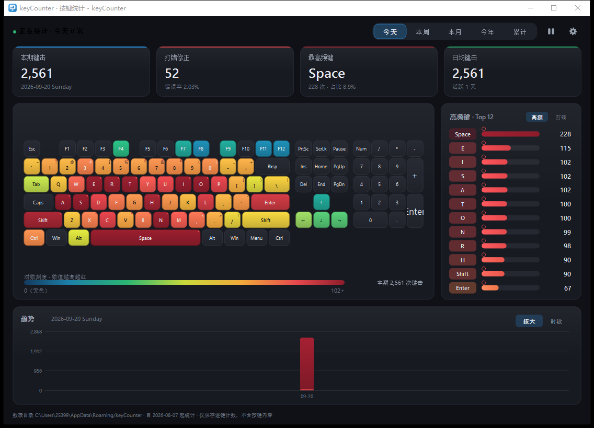

# keyCounter

> 一个常驻 Windows 托盘的按键计数与热力统计工具：统计每个物理按键的按下次数、错误次数，
> 以「热力虚拟键盘」一眼看出哪些键被高频使用，并按 日 / 周 / 月 / 年 / 累计 周期查看。
>
> 状态：**M0–M4 已完成且可运行**（M5 打磨中）。技术方案见 [docs/DESIGN.md](docs/DESIGN.md)，实施计划与验收记录见 [docs/PLAN.md](docs/PLAN.md)。
> 界面预览：[docs/preview-heatmap-dark.png](docs/preview-heatmap-dark.png)

---

## 核心特性

| # | 特性 | 说明 |
|---|------|------|
| 1 | 逐键计数 | 以**物理键位**（扫描码 + E0/E1 前缀）为标识，左/右 Shift、左/右 Ctrl、主回车/小键盘回车 等都能区分 |
| 2 | 多周期视图 | 今天 / 本周 / 本月 / 今年 / 自使用以来（累计），并支持日粒度趋势曲线 |
| 3 | 热力虚拟键盘 | 自绘键盘，按频率映射到「青→绿→黄→橙→红→深红」色带；无色 = 该周期内未被按下 |
| 4 | 真实键盘布局 | 内置 **104 全尺寸 ANSI / 87 TKL / 68 小配列** 三套布局，可在托盘或设置中切换，坐标与真实键盘等比例 |
| 5 | 错误按键统计 | 双口径：① 删除键（Backspace/Delete）按下次数；② 把每次删除归因到"刚打错的那个键"，得出**最常打错的键**排行 |
| 6 | 开机静默启动 | 写入 `HKCU\...\CurrentVersion\Run`（`--silent`），免管理员；托盘图标进入统计与设置 |
| 7 | 全局快捷键 | 可选（默认关闭），组合键在设置中自定义，例如 `Ctrl+Alt+K` 一键唤起面板 |
| 8 | 低占用 | 纯事件驱动、零轮询；按键热路径无锁无堆分配；常驻内存约 25–40 MB，空闲 CPU ≈ 0% |

## 技术栈（零第三方依赖）

| 层 | 选型 | 理由 |
|----|------|------|
| 语言/构建 | C++20 + CMake + MSVC 2022 | 与 Qt 6.8.2 `msvc2022_64` 工具链一致 |
| UI | **Qt Widgets + 全自绘（QPainter）** | 常驻内存最低、启动最快；热力图/图表自绘，视觉可控 |
| 采集 | **Win32 Raw Input（`RIDEV_INPUTSINK`）** | 不注入、不钩挂其他进程，异步低开销，失焦也能收到按键 |
| 存储 | **SQLite（Qt 自带 QSQLITE 驱动）** | WAL + 批量 upsert，崩溃安全，年数据量约 2 MB |
| 集成 | QtNetwork(QLocalServer) / QSystemTrayIcon / QSettings(注册表) / RegisterHotKey | 单实例、托盘、自启、全局快捷键 |

不引入任何第三方库：Qt 6.8.2 官方模块 + Win32 API 即全部依赖。

## 构建（已在本机验证：Qt 6.8.2 msvc2022_64 + MSVC 19.44 + Ninja 1.13.2）

```powershell
cmake -S . -B build -G Ninja -DCMAKE_PREFIX_PATH=D:/Qt6/6.8.2/msvc2022_64 -DCMAKE_BUILD_TYPE=Release
cmake --build build

# 运行（未部署时需把 Qt 的 bin 目录加进 PATH）
$env:PATH = "D:/Qt6/6.8.2/msvc2022_64/bin;$env:PATH"
.\build\keyCounter.exe            # 打开面板（已有实例时只唤起）
.\build\keyCounter.exe --silent   # 开机自启用：只在托盘静默运行
.\build\keyCounter.exe --dump     # 控制台打印今日/本周/本月/今年的汇总与 Top 榜

# 测试与性能基准
cd build; ctest --output-on-failure    # 7 个测试套件
.\keyCounterBench.exe 1000000          # 按键热路径微基准
.\keyCounterRawProbe.exe 15            # 采集探针：实时打印捕获到的按键
```

## 打包（免安装绿色目录）

```powershell
powershell -ExecutionPolicy Bypass -File tools/deploy.ps1
# → dist/keyCounter/  （约 44 MB：exe + Qt 运行时 + platforms + styles + sqldrivers/qsqlite.dll）
```

* 必须包含 `sqldrivers/qsqlite.dll`，否则统计数据库无法读写（脚本已自动复制）。
* 在 exe 同级放一个空文件 `portable.flag` → 数据写到 `./data`（便携模式），否则写到 `%APPDATA%\keyCounter`。
* 应用图标由 `keyCounterIconGen` + `tools/pack-ico.py` 生成（`resources/app.ico`，16→256 px 共 7 个尺寸）。

## 界面预览



> 演示数据由 `tools/gen-demo-data.py` 生成（45 天、约 46 万次键击）。

## 开发工具（tools/）

| 工具 | 用途 |
|------|------|
| `gen-demo-data.py` | 生成“像真人打字”的演示数据，用于检查热力图配色 |
| `check-db.py` | 只读查看数据库内容（逐日逐键计数、时段分布、meta） |
| `inject-test.ps1` | 注入 F13 验证采集链路（真实键盘不会产生该键） |
| `screenshot-app.ps1` | 无前台窗口也能把主面板截图成 PNG（PrintWindow） |
| `analyze-shot.py` | 对截图做像素级校验（主题色 / 热力色带命中统计） |

## 实测（Release，本机）

| 指标 | 实测 | 目标 |
|------|------|------|
| 按键热路径 | **35 ns/次** | < 2000 ns |
| 静默托盘态内存 | **28.7 MB 工作集 / 6.9 MB 私有** | < 45 MB |
| 面板打开内存 | ~100 MB 工作集（Qt GUI + 中文字形缓存） | — |
| 空闲 CPU | 0%（事件驱动，无轮询） | ≤ 0.05% |
| 单测 | 7/7 套件通过 | 全绿 |

## 目录结构（规划）

```
keyCounter/
├─ docs/            DESIGN.md（技术方案） / PLAN.md（里程碑与验收）
├─ src/
│  ├─ app/          生命周期、托盘、自启、单实例、设置
│  ├─ core/         采集内核、计数引擎、纠错归因、SQLite 存储与查询
│  ├─ layout/       键盘布局描述与内置 104/87/68 布局数据
│  └─ ui/           主窗口、自绘热力图、图表、设置对话框、主题
├─ resources/       qrc、图标、布局 JSON
├─ tests/           单元测试与注入式集成测试
└─ tools/           构建/打包脚本
```

## 隐私

只保存**逐键的聚合计数**（物理键 + 次数）；不保存按键序列、不记录窗口标题/程序名、不联网、不做上报。
运行数据位于 `%APPDATA%\keyCounter\keycounter.db`，可在设置中一键清空。

> 规划中：数据导出（CSV / PNG）、安装包 —— 均后续版本提供；本期交付免安装绿色目录。
